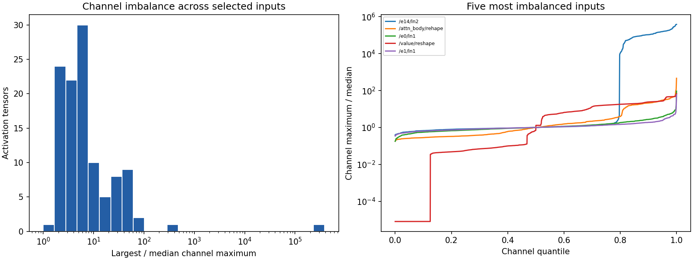

# Week 1 calibration activation analysis

1,024 calibration positions; 113 unique selected activation tensors; 160 selected matrix consumers.

The plots summarize FP32 source-network activations. They do not measure production TensorRT internal activations or latency.

| Tensor | Max / median channel maximum | Channels above 10x median |
| --- | ---: | ---: |
| `/encoder14/ln2` | 384311.28 | 156 |
| `/attn_body/rehape` | 463.16 | 144 |
| `/encoder0/ln1` | 93.24 | 2 |
| `/value/reshape` | 66.82 | 647 |
| `/encoder1/ln1` | 59.47 | 2 |
| `/encoder2/ln1` | 58.05 | 1 |
| `/encoder3/ln1` | 52.48 | 1 |
| `/encoder4/ln1` | 47.38 | 1 |
| `/policy/dense1/mish` | 41.52 | 61 |
| `/encoder5/ln1` | 40.89 | 1 |
| `/attn_body/ffn/dense1/mish` | 39.47 | 207 |
| `/encoder8/ln1` | 37.01 | 1 |

An explicit branch Div plus compensation of each selected XW weight can preserve untouched residual/unselected branches. Moving a scale into upstream normalization requires compensating every consumer. Shared Smolgen weights require one scale consistent across every use, or explicitly cloned weights with storage changes disclosed. Do not smooth each occurrence of a shared initializer independently.

Week 2 may compare five smoothing strengths (0, 0.25, 0.5, 0.75, 1) using validation only, after floating equivalence and shared-consumer checks. No smoothing or QAT is performed in this step.
