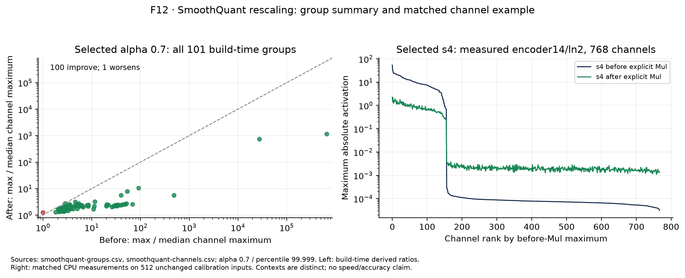
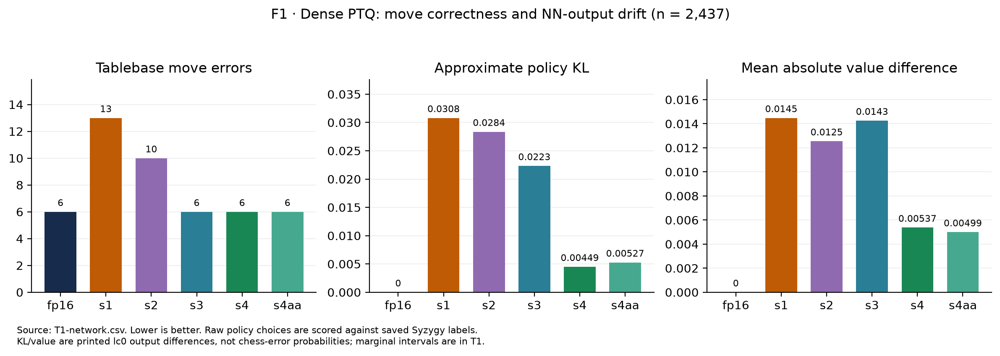
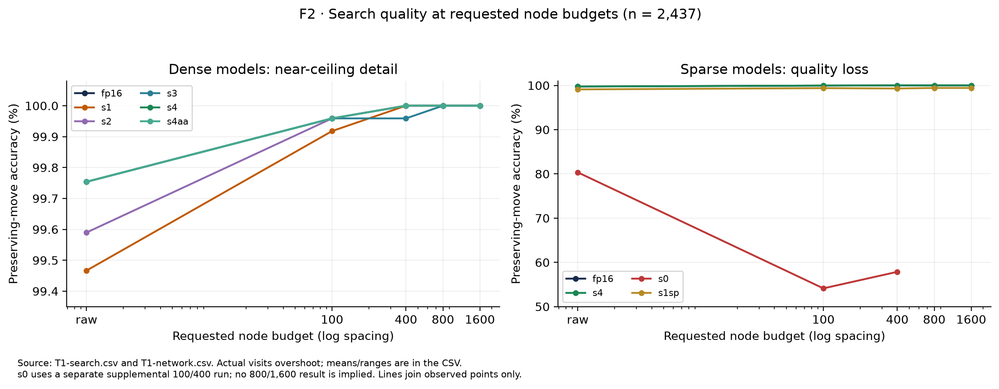
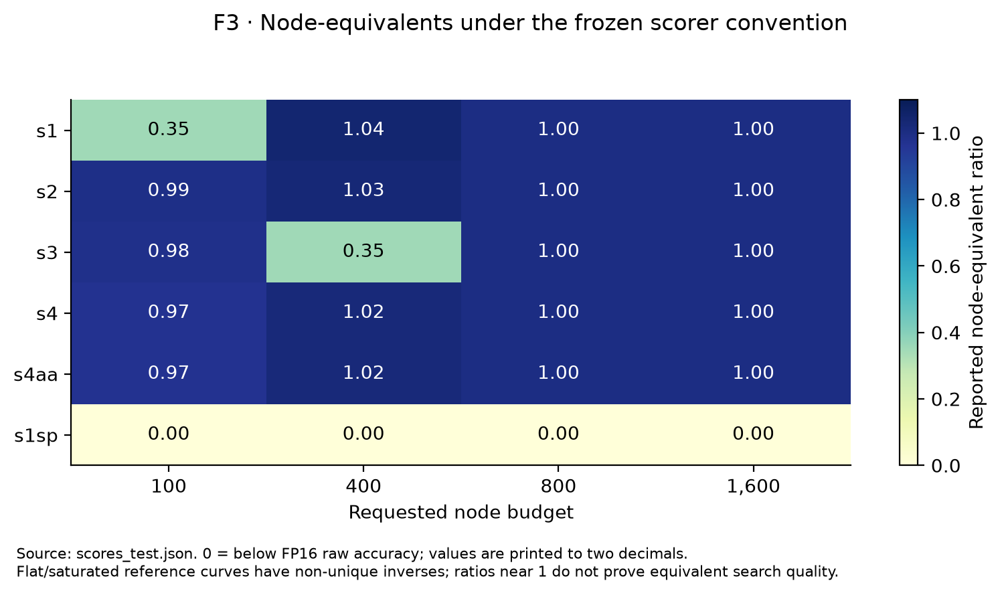
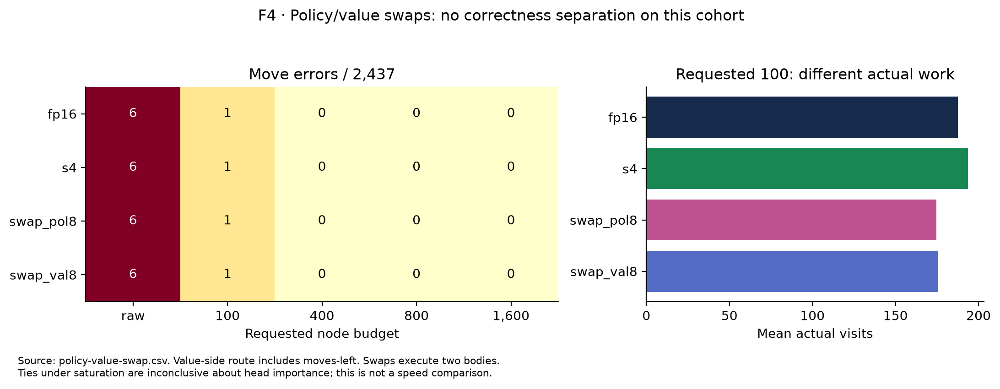

# Person A model-side report draft

Status: verified draft, not the final shared report. A5/F12 is complete, including a version-matched CPU activation diagnostic on the unchanged model and calibration inputs. Run3 systems/timed/frontier evidence is now available in analysis/person_a/run3_findings.md for final Run5 integration; this older model-side draft retains its original checkpoint wording below. Production strength and actual fresh GPU reproduction remain pending. No new chess/search or GPU performance experiment was performed for this analysis.

## Abstract — provisional shared text

We study a BT3 chess transformer deployed inside lc0 using FP16 and a cumulative W8A8 post-training quantization ladder. We separate changes in neural outputs, preservation of tablebase move results, search at requested node budgets, and performance at fixed time. Percentile calibration and SmoothQuant improve output fidelity relative to naive quantization on the evaluated endgames, while the dense search scores saturate. SparseGPT preserves quality better than magnitude pruning but retains search errors. These observations establish model-side tradeoffs; final throughput, hardware and full-game strength conclusions will be inserted after systems evidence is reviewed. A verified activation illustration explains the selected model's compensated rescaling.

## Introduction and research questions

The hypothesis is that lower-precision inference may enable more search within a time budget, and that the extra search may compensate for changed neural outputs. Each link needs evidence: an output-fidelity improvement does not prove a latency improvement, and more nodes does not prove stronger play. We ask (RQ1) how the ladder changes policy/value outputs and move selection, (RQ2) what search masks and whether output swaps separate sensitivity, and (RQ3) what the measured quality/performance/strength evidence ultimately supports. Negative and inconclusive outcomes answer these questions too.

Haque, Wei and Müller compare raw Lc0 decisions with MCTS using exact endgame solutions [1]. That study motivates separate network/search measurements, not an expectation about BT3 INT8. Our corpus, network and runtime differ. The proposal's exact historical error counts are not repeated here without a checked source table.

## Related work and methodological distinctions

Tablebase evaluation [1] motivates separating neural move choice from search. SmoothQuant [2] addresses activation ranges through compensated rescaling, while SparseGPT [3] uses calibration-dependent pruning compensation. Their LLM results are motivation, not guarantees for this chess model. GPTQ [4] is a related weight-quantization method and is not the quantizer used here. Sparse hardware support [5], roofline modelling [6] and incremental NNUE evaluation [7] provide context for distinct implementation/performance questions. None supplies a measured result for our laptop experiment.

## Model, outputs and runtime boundary

The checkpoint is `BT3-768x15x24h-swa-2790000.pb.gz`, SHA256 `e3067757d1fc2dfc66947b21d15ace0cedf4c54254fc1de83d77c378a3e8b8e1`. The exported graph accepts `[batch,112,8,8]` classical input planes and produces policy `[batch,1858]`, WDL `[batch,3]` and moves-left `[batch,1]`. Policy guides legal-move priors; WDL is the neural outcome prediction; moves-left is auxiliary. Our chess-accuracy score evaluates a selected move using external tablebase labels, not the argmax of WDL. The value-drift column is the frozen scorer's saved printed `V` difference, not a per-component WDL probability distance.

The wrapped FP16 baseline contains exported FP32 ONNX and runs through lc0 `onnx-trt optimize=6`. Quantized variants use `optimize=8`. The raw checkpoint through the same backend is a wrapping/reference check. Python CPU ONNX Runtime used for preparation is separate from lc0's bundled GPU ONNX Runtime. A runtime flag permits precision; per-model executed coverage remains a systems measurement. Graph target counts must not be labelled measured Tensor Core coverage.

## Data, scoring and analysis cohort

The adopted corpus contains 11,200 synthetic legal, nonterminal, decision-sensitive roots from 28 three-to-five-piece material classes, labelled with local Syzygy tables. Pools contain 1,120 calibration, 3,360 development and 6,720 test roots. Quantization calibration actually uses 512 inputs: 256 random-game inputs with supplied history and 256 tablebase inputs. Standalone tablebase roots use the imported FEN-only convention and zero halfmove clocks. The primary evaluated cohort is the same 2,437 test IDs for every model.

The imported rule maps Syzygy +2 to win, -2 to loss and 0/±1 to draw. A selected move is correct if it preserves the root category; DTZ-optimal rate is secondary. Missing conditions are not losses or zero values. We retain the original labels, results and scorer.

Seven symmetry-equivalence groups cross pool splits, affecting measured IDs 611, 627 and 965. The grouping and actual calibration membership are recorded in `analysis/person_a/run1/cohort_audit.json`. This limits a fully independent holdout claim. We preserve and disclose the primary results; no roots were silently removed. The 43-position hard subset was defined using viewed FP16 test outputs and is descriptive, not another model-selection set.

## Quantization methods and development selection

The ladder is s1 per-tensor signed symmetric minmax W8A8; s2 adds per-channel weight scales; s3 uses selected percentile 99.999; s4 adds SmoothQuant alpha 0.7. The attention extension s4aa additionally quantizes dynamic matrix products. The active graphs request QDQ on 164 fixed-weight matmuls in s4 and all 195 matmuls in s4aa. Biases, normalization, softmax and other floating work are not described as uniformly INT8. Calibration and recipe selection use their prescribed pools; final test plots are not used to choose a new recipe.

SmoothQuant transfers range imbalance between activations and weights [2]. For positive scales, `XW = (X/s)(sW)` before rounding. This implementation inserts explicit branch Mul nodes instead of unrestricted LayerNorm folding because residual/shared consumers must remain correct; shared global Smolgen weights constrain per-block smoothing.

F12 separates the selected alpha-0.7 model's 101 build-time group summaries (original activations with algebraically derived rescaling) from a measured before/after pair at `/encoder14/ln2`. Of the 101 groups, 100 reduce the peak/median channel-maximum ratio; `/attn_body/embedding/reshape` instead increases from 1 to 1.2492. The measured 768-channel example uses the same 512 calibration inputs on CPU. Its peak/median ratio falls from 676,662.01 to 1,131.17, and all channels satisfy the original scaling tolerance (maximum observed difference zero). A channel maximum spans all calibration inputs and board tokens; this ratio describes range imbalance, not WDL or chess accuracy. This diagnostic does not verify GPU runtime precision or acceleration.

The original A5 check paired C1 measurements (alpha 0.5, percentile 99.99) with the final C2 model (alpha 0.7, percentile 99.999). Collection-log/backup hashes and an exact 768-channel scaling match identify that earlier model. We preserve the historical arrays and failed check; F12 uses newly collected final-model arrays instead. Provenance, CPU execution context and checks are in `analysis/person_a/a5/` and `analysis/person_a/run1/smoothquant_verification.json`. Quantization, models, calibration and scoring were unchanged.

Magnitude pruning retains the largest two values per group of four along the reduction dimension. SparseGPT uses calibration-dependent compensation [3]; the imported implementation is sequential across 98 dependency stages with 512 calibration inputs. Both pruned source graphs were checked: all 150 unique targeted matrices satisfy at most two nonzeros per K-group of four. The sparse branch is pruned before best-recipe quantization. This experiment is not GPTQ weight quantization, though GPTQ provides related second-order compression context [4].

## RQ1 — Network-level results

| model | correct/n | accuracy % | approx KL | top1 | mean abs(delta V) |
|---|---|---|---|---|---|
| fp16 | 2431/2437 | 99.7538 | 0 | 1.0000 | 0 |
| s1 | 2424/2437 | 99.4666 | 0.0308038 | 0.8203 | 0.0144801 |
| s2 | 2427/2437 | 99.5897 | 0.0283619 | 0.8071 | 0.012547 |
| s3 | 2431/2437 | 99.7538 | 0.0223192 | 0.8363 | 0.0142551 |
| s4 | 2431/2437 | 99.7538 | 0.00449441 | 0.8880 | 0.00537033 |
| s4aa | 2431/2437 | 99.7538 | 0.00526667 | 0.8794 | 0.00499163 |
| s0 | 1958/2437 | 80.3447 | 0.745628 | 0.4407 | 1.40423 |
| s1sp | 2415/2437 | 99.0973 | 0.0740766 | 0.7920 | 0.0338939 |

The complete T1 table includes secondary DTZ scores, Wilson intervals and paired discordances. Policy KL is approximate because lc0 prints rounded priors; top1 on printed priors is distinct from the selected legal best move. Multiple comparisons are descriptive; isolated unadjusted p-values are not global superiority claims.

FP16 and s4 each make six preserving-move errors, but s4 has nonzero policy/value drift. Per-channel weighting does not monotonically improve every metric. Selected clipping and smoothing reduce divergence relative to naive PTQ. s4aa has the same move score here with somewhat different output fidelity. None of these results assigns all INT8 variants the same speed.

## RQ2 — Search, actual budgets and the hard subset

Study B uses requested 100/400/800/1,600 nodes, Threads=1, MinibatchSize=256 and smart pruning off. Actual visits overshoot, so requests are not exactly equal completed work. At larger budgets the dense scores approach or reach the ceiling. The 43-position supplementary analysis preserves the existing 10/25/50/100/200 requests, paired identities and actual-node distributions; it neither adds search nor tunes the model.

Node-equivalents use the imported monotone reference envelope and inverse in log node count. A flat reference curve has an interval of inverse solutions; the scorer chooses a point near the compared model's node count. Ratios near one under saturation are therefore not precise evidence of equivalent search efficiency. Zero indicates a score below reference raw accuracy, not zero work.

The hard-set curves have few discordant positions and can be non-monotone. A one-position change or crossing curve is weak evidence of a systematic gain. The per-condition table contains confidence intervals and exact paired counts rather than treating every point as a separate success claim.

## Policy/value swaps

`swap_pol8` takes policy from s4 and value/moves-left from the FP16-side graph; `swap_val8` reverses these routes. Source/stitched ONNX and wrapped identities agree with the recorded provenance. These evaluate two bodies and are used only for fixed-node quality comparisons. Different TensorRT builds can retain small numerical differences even in the nominally floating branch, and moves-left changes with value; the experiment is not a perfectly isolated intervention on a single scalar output.

All four configurations have the same aggregate correctness counts here: six raw errors, one at requested 100 and zero at the larger budgets. Actual visit counts differ. The saturated test does not identify which head's error is more harmful; a tie does not establish equal head importance.

## Sparse quality findings

Both sparse source graphs satisfy <=2 nonzeros per four along K for all 150 unique target matrices. SparseGPT uses 98 dependency stages and 512 calibration inputs. Across the 150 reported matrices, median reconstruction error is 0.00690805 versus 0.0895317 for magnitude; SparseGPT is lower on 150 matrices. These are calibration reconstruction losses measured against the corresponding stage targets, not test move-error rates or a guarantee of global forward equivalence.

The sparse model improves substantially over magnitude pruning in raw accuracy, but still has persistent losses after search; the 1,600-node s1sp error cases are retained in sparse-move-errors.csv. Several matrices have few calibration rows relative to K; these warnings and sequential-target differences are limitations, not a demonstrated cause of the remaining chess errors. No retraining, repruning or additional calibration was performed.

**WAIT R1/R2:** whether sparse tactics execute and whether they accelerate either lc0 or standalone trtexec. A valid 2:4 mask and a better reconstruction objective do not establish those hardware claims.

At requested 1,600 nodes, s1sp retains 14 errors versus 0 for FP16 on the common cohort. Magnitude pruning has only supplemental 100/400-node search results, kept separate; no later points are invented. Per-position mistakes and calibration-row warnings are saved with the analysis tables. Theoretical sparse arithmetic support [5] does not establish selected sparse tactics or end-to-end speed here.

## Model work and systems handoff

The verified active graph contains 195 matrix operations: 164 fixed-weight and 31 dynamic. Matrix work is 4,539,245,056 MACs per position, or 9,078,490,112 arithmetic operations under the two-ops-per-MAC convention. This excludes non-matmul work. The model side provides per-operation geometry, batch scaling and a traffic model; fused timings, actual operand/output representations and measured peaks remain R1 inputs. Logical traffic is not measured DRAM traffic. Roofline is an explanatory model [6], with the implementation caveats recorded separately.

**WAIT R1/R2:** actual layer/precision/sparse execution, measured roofline and comparable/repeated NN/search performance. Sparse-enabled standalone trtexec and actual lc0 timings remain different conditions. **WAIT R4:** match outcomes and Elo. GPU energy/node, when supplied, is not the omitted equal-energy accuracy test. NNUE illustrates a different evaluation/search design [7]; it is related context, not another measured baseline.

## Existing fixed-time review and provisional RQ3 interpretation

| model | nominal_ms | n | correct | accuracy | worse | better | mcnemar_p | nodes_mean | nodes_median | reported_ms_mean | wall_ms_mean | mean_nodes_ratio_vs_fp16 |
|---|---|---|---|---|---|---|---|---|---|---|---|---|
| fp16 | 200 | 2437 | 2436 | 0.9995896594173164 | 0 | 0 | 1.0 | 3711.2560525235945 | 500.0 | 183.25194911776774 | 184.35281083299137 | 1.0 |
| s4 | 200 | 2437 | 2437 | 1.0 | 0 | 1 | 1.0 | 3768.6093557652853 | 731.0 | 182.73779236766515 | 183.82691834222405 | 1.015453879341656 |
| fp16 | 800 | 2437 | 2437 | 1.0 | 0 | 0 | 1.0 | 14975.06565449323 | 2863.0 | 605.30734509643 | 606.4201066885515 | 1.0 |
| s4 | 800 | 2437 | 2437 | 1.0 | 0 | 0 | 1.0 | 18084.294214197784 | 3959.0 | 593.6815757078375 | 594.6756668034469 | 1.207627040270881 |

Both models already have the required raw runs. Extra historical FP16 rows are excluded by frozen IDs, not deleted. At 200ms only one paired correctness discordance separates the models; the exact paired test does not support a robust gain. At 800ms both are perfect on this cohort. More mean nodes does not itself establish a stronger player. Early stopping yields elapsed times below nominal budgets and skewed node distributions, so means, medians and time context are retained.

**R3 is final alignment, not a reason to rerun these experiments.** B owns the canonical F5; A supplies this interpretation. Final throughput conclusions wait R2 and full-game conclusions wait R4.

## Limitations and provisional conclusion

The study uses one checkpoint/device, synthetic decision-sensitive endgames, limited accuracy headroom, printed-output approximations and requested budgets with overshoot. Cross-split symmetry overlap, test-defined hard analysis and sparse calibration coverage constrain generalization. The finite repeated opening book and match uncertainty need review after actual games arrive. F12 is a calibration-input illustration at one layer, not a network-wide distribution or independent performance/accuracy result.

The current evidence supports model fidelity/quality tradeoffs and substantial masking of dense-model errors by search on this corpus. It does not yet establish a full-game playing-strength gain. Final conclusions require the independent hardware/time/match evidence and shared review; a negative or inconclusive result remains a valid answer.

Accepted scope omissions are search-visited calibration, partial INT8, QAT/KD/recovery, the additional R32 baseline, one-second timing, CPU/whole-machine energy, equal-energy accuracy (F8) and accuracy-versus-batch (F10). No new variants were introduced to obtain a positive outcome.

## Final integration checklist

- A5/F12 is verified; retain its model/statistics identities when reproducing the illustration.
- Integrate R1/R2/R4 measured findings and align R3 with B's canonical report; audit paired conditions and uncertainty.
- Combine A/B contributions to the abstract, introduction, related work, discussion, limitations and conclusion.
- Complete the shared report/presentation/demo and verify the final package/reproduction (R5).
- Reproduction must include FP16, best PTQ s4 and the selected sparse path or its documented runtime limitation; repository smoke tests alone are insufficient.

References and checked claim scope: [references.md](references.md) and [reference_audit.json](reference_audit.json). Source-to-claim links: [claim_register.md](../../analysis/person_a/run1/claim_register.md).
