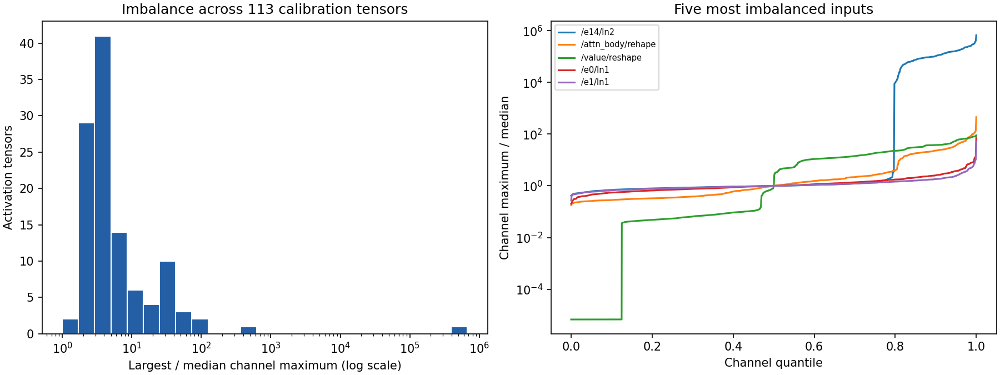

# Active Week 1 activation analysis

1,024 calibration positions; 113 unique selected activation tensors; 160 matrix consumers. No validation/test activations used.

FP32 source-network activations with TF32 disabled; this does not measure production TensorRT internal values or latency.

| Tensor | Max / median channel maximum | Channels above 10x median |
| --- | ---: | ---: |
| `/encoder14/ln2` | 674172.86 | 156 |
| `/attn_body/rehape` | 456.21 | 145 |
| `/value/reshape` | 91.06 | 864 |
| `/encoder0/ln1` | 74.62 | 5 |
| `/encoder1/ln1` | 51.96 | 2 |
| `/encoder2/ln1` | 47.47 | 1 |
| `/policy/dense1/mish` | 44.43 | 116 |
| `/encoder3/ln1` | 41.06 | 1 |
| `/encoder4/ln1` | 36.87 | 1 |
| `/encoder5/ln1` | 32.89 | 1 |
| `/encoder8/ln1` | 31.33 | 1 |
| `/encoder6/ln1` | 31.25 | 1 |

An explicit branch Div plus compensation of each selected XW weight can preserve untouched residual/unselected branches. Moving a scale into upstream normalization requires compensating every consumer. Shared Smolgen weights require one scale consistent across every use, or explicitly cloned weights with storage changes disclosed. Do not smooth each occurrence of a shared initializer independently.

All 1,024 instrumented network outputs were checked against the original FP32 model. Named statistics are in [the report](../results/week1-v2/calibration-outliers.json). No smoothing, training, optimizer update, QAT or distillation was performed.

A very large max/median ratio can reflect a near-zero median as well as a large peak. Absolute maxima and medians are included in the JSON; ratios alone are not evidence of large absolute activations. The histogram uses a logarithmic horizontal axis.
