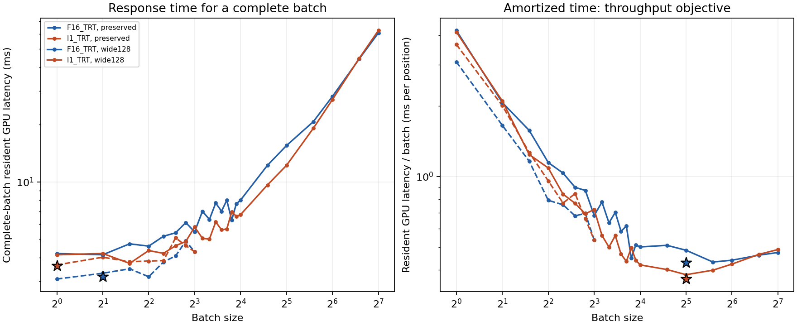

# Person A Week 1: active verified handoff

Person A model/data responsibilities are complete. Person B integration, search/scoring extensions, systems/energy work and joint C1 remain separately unverified. Week 2 has not started.

The active run is `syzygy-v2` / `week1-v2`. Historical artifacts under `data/syzygy`, `results/week1` and the original handoff remain preserved.

| Completion step | Verified outcome | Evidence |
| --- | --- | --- |
| 1 / A13 | 13,072 published four/five-piece roots and documented mirrors; source, splits, local labels and native fen_only encoding verified | [Input verification](../environment/week1-input-refresh.json) |
| 2 / A14 | Exact two floating baselines, native/batch checks, all-split chosen-move accuracy and numerical drift | [Baseline results](../results/week1-v2/baseline-accuracy.json) |
| 3 / A15 | Naive INT8 recalibrated; actual execution, reload, wrapper, validation and batch tuning | [Pilot](../environment/week1-v2-int8-pilot.json) |
| 4 / A16 | Calibration-only activation statistics and existing-port forward compatibility | [Analysis](../environment/week1-v2-analysis.json) |
| 5 / A17 | Artifact, scoring, historical-preservation and handoff audit | [Audit](../environment/week1-v2-audit.json) |

## Network-only chosen-move accuracy

Select the highest legal policy probability (float32 softmax, temperature 1, lexical UCI ties). A W→D/L or D→L move is an error, judged from the original mover’s perspective by external theoretical Syzygy WDL. Tablebases do not supply the NN inputs or select its move. This measures move-outcome preservation, not the NN value head’s WDL class, MCTS strength, Elo, or DTZ-optimality.

| Split | R32_CUDA | F16_TRT | I1_TRT |
| --- | ---: | ---: | ---: |
| calibration | 1,019/1,024 (99.5117%) | 1,019/1,024 (99.5117%) | Not evaluated |
| validation | 2,044/2,048 (99.8047%) | 2,044/2,048 (99.8047%) | 2,046/2,048 (99.9023%) |
| test | 9,990/10,000 (99.9000%) | 9,990/10,000 (99.9000%) | Not evaluated |

Test decision-sensitive subset: 6,967 roots; FP16 accuracy 99.8565%. This subset merely has at least one outcome-losing move; it is not the later hard-subset definition. All saved selected moves and outcomes were independently recomputed and locally tablebase-probed.

**Research limitation:** both floating baselines make only 10 errors in 10,000 test roots. This benchmark leaves little accuracy headroom for demonstrating a further search benefit; the later hard-subset/search study must account for that. No dataset redesign or test-driven tuning was performed.

The corpus is balanced by piece count, side and W/D, using one published game root per game, plus documented color/rank mirrors. It uses four/five pieces, not six/seven. Halfmove clocks are normalized under the theoretical-WDL contract, which ignores the fifty-move limit. Both corpus and history differ from the historical 55.42% result, so their individual contributions are not isolated.

## Numerical outputs and correctness

The network emits 1,858 policy logits, three side-to-move value probabilities (win/draw/loss), and one moves-left estimate. WDL numerical drift compares the value probabilities between runtimes; it is separate from tablebase chosen-move accuracy.

FP32 passed the 32-case native Eigen and batch-consistency checks within the original FP32 gates. FP16 is explicitly retained as a separately measured baseline, with raw numerical failures preserved rather than relabeled as passes.

| Split | Maximum FP16/FP32 WDL component difference | Positions failing any recorded legacy check |
| --- | ---: | ---: |
| calibration | 4.2865 percentage points | 2 |
| validation | 3.5717 percentage points | 3 |
| test | 2.7940 percentage points | 19 |

One test FP16 WDL row has a probability-sum error of about 0.1058 percentage points, just above the legacy comparator’s 0.1-point check. The existing standalone-runner validity check is 0.2 points. This failed legacy check is recorded; raw outputs were not normalized. Historical larger-drift evidence and earlier acceptance also remain intact.

## INT8 artifact and scope

All 1,024 calibration roots supplied the new max-calibration scales. Scope v2 remains 160 selected fixed-weight multiplications, 99.9905% of unique matrix weights and 97.8425% of matrix MACs. All selected operations were mapped to actual INT8 execution; kernel traces confirm it.

The recipe is signed symmetric per-tensor W8A8. Selected multiplications use INT8 operands and INT32 accumulation; TensorRT may emit FP32 dequantized intermediates, FP16 or requantized INT8. Four tiny weighted operations, 31 dynamic matrix products, normalization and other exceptions remain floating as documented. This is a mixed-precision model. ONNX Q/DQ weight source constants remain FP16, while engine operand execution and storage are separately audited.

Saved-engine reload outputs match exactly. The lc0 wrapper contains a byte-identical copy of the new ONNX graph. Actual lc0 GPU integration is still Person B’s work. No INT8 final-test evaluation or training was performed.

## Best measured batch settings

Timings are warmed, sequential standalone inference on this RTX 4060 Laptop GPU. Complete-batch latency is the wait for the whole request; amortized time divides that latency by batch size and describes throughput. Larger batches do not make a single waiting position finish in the amortized time.

| Objective | FP16 best batch | FP16 time | INT8 best batch | INT8 time | INT8 / FP16 |
| --- | ---: | ---: | ---: | ---: | ---: |
| Resident GPU complete batch | 2 | 3.17890 ms | 1 | 3.61819 ms | 1.1382× |
| Host-input to host-output complete batch | 1 | 3.66354 ms | 1 | 4.05361 ms | 1.1065× |
| Resident GPU amortized per position | 32 | 0.42974 ms | 32 | 0.36580 ms | 0.8512× |
| Host pipeline amortized per position | 64 | 0.47518 ms | 33 | 0.42411 ms | 0.8925× |

A ratio below 1 favors INT8; above 1 favors FP16. These are independently selected best measured settings, with fresh finalist repeats. Exact engine identities and all raw sweep samples are in [batch tuning](../results/week1-v2/batch-tuning.json).



The exact accepted FP16 baseline supports batches 1–8 and was preserved. Separate timing engines extend the same graphs/precision controls to larger batches; their profiles, tactics, actual precision, reload and numerical differences are recorded separately. They do not silently replace the baseline used for the accuracy table. No global optimum or effective MCTS nodes/s gain is claimed.

**Search-quality caution:** on validation, naive INT8 and FP16 choose the same top legal move on 88.18% of positions, and the largest value-head WDL component difference is 92.88 percentage points. High tablebase move preservation does not establish equal value estimates or equal MCTS quality. Later quantization recovery and search evaluation remain necessary.

## Activation analysis and port

All 1,024 calibration roots supplied exact per-channel maxima, means and RMS at 113 unique activation inputs serving 160 selected matrix consumers. Instrumented outputs were checked against FP32 on every calibration root. [Plots and named analysis](week1-v2-activation-analysis.md).

The unchanged exact-operator PyTorch port passed FP32 forward checks on 32 preselected calibration cases at batch sizes 1 and 8. The earlier gradient-feasibility result is reused after checking identities. No optimizer, smoothing, QAT or distillation ran.

## Identities and reproduction

- [Active data manifest](../data/syzygy-v2/manifest.json) and [protocol](../environment/week1-v2-protocol.json).
- [Original floating baseline specifications](../environment/step5-baselines.json); active history is fen_only under the new protocol.
- [INT8 graph audit](../environment/week1-v2-i1-graph.json), [primary engine record](../environment/week1-v2-i1-engine.json), and [wrapper](../models/wrapped/bt3-i1-v2.pb.gz).
- [Current evidence manifest](../environment/week1-v2-evidence-manifest.json) and [progress](../environment/week1-progress.json).

The following are the executed commands, in order, from the project root inside Ubuntu-22.04 WSL, using `/home/anjanrd/.local/share/lc0-int8/venv/bin/python` and `PYTHONDONTWRITEBYTECODE=1`. Original data acquisition commands are documented in the roadmap. Existing verified outputs are preserved; a full fresh rerun needs a separately versioned output/runtime location rather than overwriting this frozen run. TensorRT rebuilds may choose different tactics.

```text
python scripts/complete_week1_v2.py initialize
python scripts/complete_week1_v2.py baselines
python scripts/refresh_int8_week1.py quantize
python scripts/refresh_int8_week1.py build
python scripts/refresh_int8_week1.py audit
python scripts/refresh_int8_week1.py quality
python scripts/refresh_int8_week1.py wrap
python scripts/tune_batches_week1.py
python scripts/refresh_analysis_week1.py statistics
python scripts/refresh_analysis_week1.py port
python scripts/handoff_week1_v2.py audit
python scripts/handoff_week1_v2.py finalize
python scripts/handoff_week1_v2.py verify
```

Runtime engines, build files and kernel traces stay outside the project under `/home/anjanrd/.local/share/lc0-int8/week1-v2/`. No project tmp folder was created.

## Remaining work outside Person A Week 1

Person B retains actual lc0 GPU/provider integration, DTZ/hard-subset scoring work, fixed-node and one-second MCTS, integrated throughput/profiling and energy instrumentation. Joint C1 awaits its own evidence. Week 2 retains the quantization-improvement ladder. Batch tuning and NN accuracy alone do not establish the project’s full speed→nodes/s→accuracy chain.
